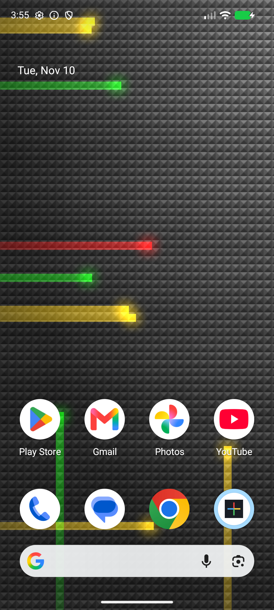

# Nexus Classic for Android

The Android 2.1–2.2 Nexus live wallpaper, recreated for modern Android with the original AOSP artwork and animation rules.

**[Download the APK](https://github.com/xefensor/nexus-classic-android/releases/latest)** · [Desktop version](https://github.com/xefensor/nexus-classic-plasma)



## Install

Requires **Android 12 or later** and live wallpaper support. Download the release APK on your phone, open it and allow installation from that source when Android asks. Open **Nexus Classic**, then **Preview & set wallpaper**. Choose your home screen, lock screen or both in the system picker; available choices depend on your Android version and launcher.

The app works offline, has no ads or analytics, and requests no network permission. Installing it does not automatically change your wallpaper.

## The original look

- The original pyramid, trail and glow textures, with the Android 2.2 colours and additive blending.
- Twenty ambient trails with random directions, speeds and restart delays.
- A tap sends four differently coloured trails out from the nearest grid cell. Up to forty extra trails can coexist without replacing earlier bursts.
- Launcher taps and icon drops trigger bursts when the launcher sends the corresponding wallpaper commands. Swipes and holds do not generate repeated bursts.
- Square tiles and proportional artwork: on a 1080 × 2400 Pixel 8a, the portrait viewport corresponds to 480 × 1066⅔ artwork pixels. The taller screen shows more vertically, without stretching the old 480 × 800 composition.
- Horizontal wallpaper scrolling when supplied by the launcher; a stationary wallpaper otherwise. Launcher zoom and dimming are controlled by Android.

## Rendering and battery use

The native Kotlin wallpaper uses OpenGL ES 2.0. It draws one background and at most two batches of trail/glow sprites, with no fullscreen loop over every trail. The renderer reuses its buffers and textures and uses elapsed time so animation speed is the same at both frame rates.

**60 fps** is the default target. Select **30 fps** in the app to reduce rendering frequency. Android Battery Saver also selects 30 fps. Rendering callbacks stop while hidden, and each engine releases its GL context and textures when its surface is destroyed. The wallpaper does not request a 120 Hz display mode or use a foreground service or wake lock.

These are rendering targets, not a measured battery-life promise. See [validation results and device limitations](docs/validation.md).

## Build

Use a complete **JDK 25**, Android SDK platform **37.0** and Build Tools **36.0.0**. The repository pins AGP 9.4.0 and Gradle 9.6.1, including the Gradle distribution checksum. No NDK is needed.

```sh
sdkmanager 'platforms;android-37.0' 'build-tools;36.0.0'
# Set ANDROID_HOME, or add sdk.dir=/path/to/Android/Sdk to local.properties.
./gradlew testDebugUnitTest lintDebug assembleDebug
adb install -r app/build/outputs/apk/debug/app-debug.apk
```

With an emulator or authorized device connected:

```sh
./gradlew connectedDebugAndroidTest
```

The JVM tests cover the original pulse rules, expiry and pool limits, frame-rate independence, Pixel 8a geometry and visible-time clock. Instrumentation checks actual rendered pixels after a tap, pause/resume, surface recreation and saved frame-rate settings.

`./gradlew assembleRelease` produces an unsigned, optimized release APK unless you provide an ignored `signing.properties` file:

```properties
storeFile=/absolute/path/to/private/release.p12
storePassword=your-store-password
keyAlias=your-key-alias
keyPassword=your-key-password
```

Keep this file and the signing key private, and back up the key to retain the ability to publish compatible updates. The APK on GitHub Releases is signed; CI uses no release signing credentials.

For renderer diagnostics:

```sh
adb shell dumpsys activity service cz.xefensor.nexusclassic/.NexusWallpaperService
```

Each active engine reports visibility, surface dimensions, frame-rate target, frame count and any renderer failure. Compare frame counts while visible and hidden to check lifecycle behaviour.

## Attribution

Original artwork and behaviour: Copyright 2009 The Android Open Source Project, Apache-2.0. The reference is [AOSP Basic wallpapers, tag android-2.2_r1](https://android.googlesource.com/platform/packages/wallpapers/Basic/+/android-2.2_r1/), commit `0e5bf9291034aaf2a7ae8ae82de5a8a7024435ff`. See [NOTICE](NOTICE), [AOSP_NOTICE](AOSP_NOTICE) and [LICENSE](LICENSE).

`tools/prepare_assets.py` derives the small tile and broad lighting textures from the unchanged AOSP background; running it requires Pillow. The Android renderer and lifecycle implementation replace the old RenderScript implementation.
